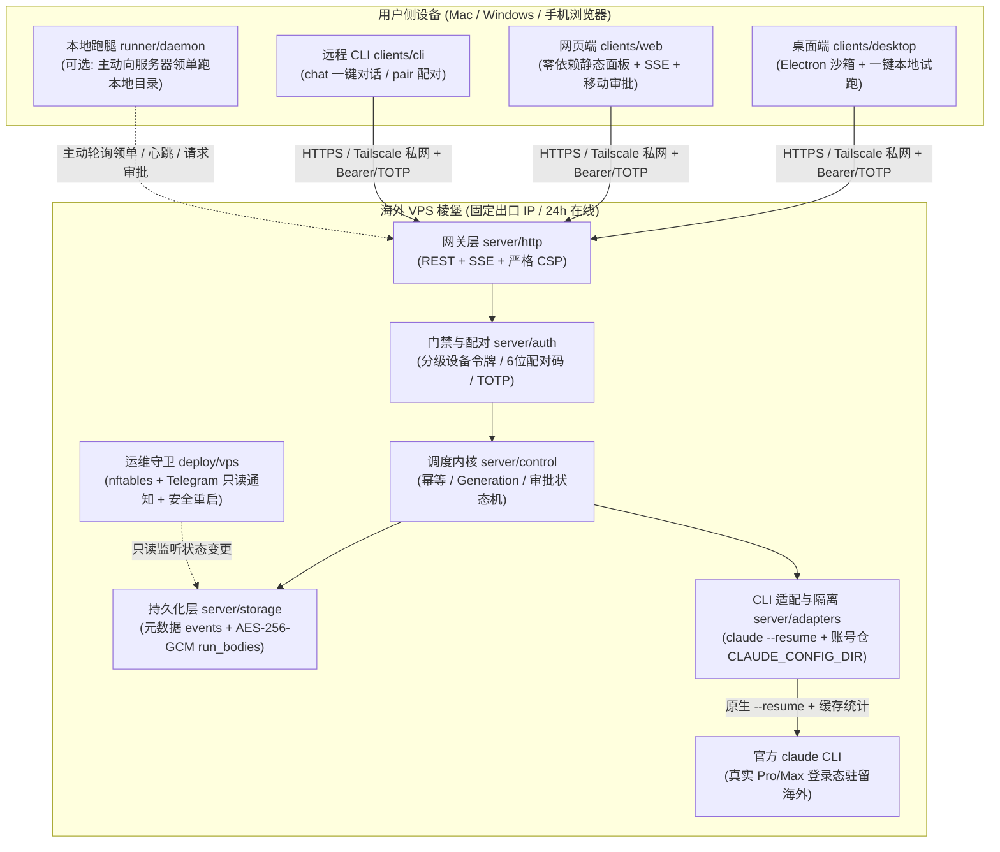

# BastionCC（棱堡）

[](https://github.com/liangsiweiethan-wq/bastion-cc/actions/workflows/check.yml)
[](LICENSE)
[](package.json)
[](package.json)

[English](README.en.md) · [宣发文案](docs/launch-kit.md) · [架构设计](docs/architecture.md) · [威胁模型](docs/threat-model.md) · [能力矩阵](docs/capabilities.md)

**把官方 Claude Code CLI 稳固地部署在可信海外服务器（棱堡）中，通过原生 `--resume` 完整保留高缓存命中率与上下文；你在电脑、浏览器或手机上只需轻量化直连，就能实现 24 小时不断线运行、多账号防串线隔离、本地跑腿执行与高危审批。**

---

## 为什么做 BastionCC（棱堡）？

很多在海外服务器自托管 **Claude Code** 的开发者都会踩中两个坑：

| 方案对比 | 痛点与瓶颈 |
| :--- | :--- |
| **服务器跑 CLI + 反代 API 给本地 API 客户端** | 第三方 API 客户端会按自定义 system prompt 与数组重拼请求，破坏 Anthropic 前缀对齐与官方压缩策略，`cache_read_input_tokens` 骤降，**Pro/Max 订阅额度几轮就会烧穿** |
| **纯 SSH 连服务器敲终端 CLI** | 缓存命中率高、额度耐用，但 **没有桌面端 / 网页端 / 手机审批端**，项目多了难以搜索、分叉、导出，断网后还要手动捞记录 |
| **BastionCC（棱堡）方案** | **服务端直呼官方 `claude` CLI（自动 `--resume <session_id>` 保缓存），外层套自研轻量控制网关 + 全套客户端（Desktop / Web / CLI / Mobile 配对）+ 多账号隔离仓** |

---

## 核心特性

1. **原生 CLI `--resume` 保缓存 + 实时缓存命中率监控**
   - `ClaudeCliProviderAdapter` (`CCRF_PROVIDER=claude-cli`) 直接调用官方 `claude -p ... --output-format stream-json`，自动提取 `session_id` 与 token 用量（含 `cache_read_input_tokens` / `cache_creation_input_tokens`）。
   - 同一会话的后续提问自动追加 `--resume <session_id>`，最大化命中 Anthropic Prefix Cache；控制面板实时汇总显示 **估算 Token 与缓存命中率（%）**。
2. **多账号隔离仓（Cage Profile）与美西指纹一致性**
   - 支持按会话切换 `accountProfile`（如 `pro-1` / `pro-2`），配合 `CCRF_ACCOUNTS_ROOT` 为每个账号隔离独立的 `CLAUDE_CONFIG_DIR`，并注入一致的美西时区与语言指纹（`TZ=America/Los_Angeles`、`LANG=en_US.UTF-8`）。
   - Electron 桌面端自带 `link-router.mjs`：拦截 Claude 官方域名并拉起隔离代理浏览器，普通链接（如 GitHub）交还系统浏览器，**无需破坏性拆包第三方二进制**。
3. **三端合一工作台（桌面端 + Web 端 + 远程 CLI）**
   - **桌面端 (`clients/desktop`)**：Electron 沙箱加固壳，自适应系统深浅色模式（Dark / Light Mode），支持 **⚡ 一键启停本地服务**、**🏃 本机执行器**、SSE 实时流推送、**6 位配对码直连** 与原生项目目录选择器。
   - **Web 工作台 (`clients/web`)**：零外部构建依赖，严格 CSP，支持 **异步长任务执行 + SSE 自动实时刷新正文与审批态**、**6 位配对码登录**、项目目录分组、实时检索、会话内联重命名、分叉（Fork）、导出 Markdown、草稿自动保存、Enter 防误触（中文输入法 IME 安全）。
   - **远程 CLI (`clients/cli` / `bastioncc`)**：内置 `chat <sessionId> <prompt>` 一行对话、**`repl <sessionId>` 交互式终端续聊**（`/status` `/metrics` `/exit`）与 `--json` 结构化输出模式。
4. **手机与新设备 6 位一次性配对码 + 持久化分级令牌**
   - `POST /v1/devices/pair-code` 生成 5 分钟单次有效 6 位配对码；远程端在网页、桌面端或 CLI 凭 `pair <code>` 兑换限域（`control` / `read` / `runner`）令牌；内置连续失败锁定防爆破，已授权及已吊销设备持久化存入 SQLite，重启不失效。
5. **控制 / 正文 / 执行 三面分离**
   - **事件与正文物理隔离**：SQLite `events` 表只存元数据与序号，对话正文独立写入 `run_bodies`（支持 `CCRF_BODY_KEY` 开启 `AES-256-GCM` 静态加密与空闲压缩），通知与断线恢复绝不泄露对话或密钥。
   - **本机反向跑腿 (`OutboundRunnerDaemon`)**：无需为家庭宽带或笔记本开放入站端口，主动向总机领单并在本地项目目录受限执行，高危操作挂起等待网页/桌面确认。
   - **VPS 运维加固套件 (`deploy/`)**：包含只清理自身表而不破坏 Docker NAT 的 `nftables` 模板、BBR/zram 优化、安全定时重启守卫（存在运行中任务自动延期）、只读降权 Telegram 完工通知器与失败即阻断的 `network_check.py`。

---

## 系统全景架构



---

## 60 秒快速上手

环境要求：**Node.js 24+**（推荐 Node.js 26 以使用内置 `node:sqlite`）。

### 方式一：本地无账号试跑（使用内置 Mock Adapter）

```sh
git clone https://github.com/liangsiweiethan-wq/bastion-cc.git bastion-cc
cd bastion-cc

install -d -m 700 .local
CCRF_EVENT_DB="$PWD/.local/events.sqlite" \
CCRF_PROVIDER=mock \
npm run start:server
```

启动后直接打开浏览器访问 `http://127.0.0.1:8787/` 即可体验完整 Web 工作台；也可在安装 Electron 后启动 `clients/desktop` 桌面工作台。

### 方式二：海外 VPS 生产接入服务器原生 `claude` CLI

在已完成官方 `claude` CLI 登录的海外 Linux 服务器上：

```sh
install -d -m 700 /var/lib/bastion-cc
export CCRF_BIND_HOST="127.0.0.1" # 兼容别名 CCRF_HOST；公网绑定强制要求 authToken
export CCRF_BIND_PORT="8787"      # 兼容别名 CCRF_PORT
export CCRF_EVENT_DB="/var/lib/bastion-cc/events.sqlite"
export CCRF_BODY_KEY="REPLACE_WITH_LONG_RANDOM_PASSPHRASE"
export CCRF_AUTH_TOKEN="REPLACE_WITH_STRONG_BEARER_TOKEN"
export CCRF_PROVIDER="claude-cli"
# 可选：开启多账号目录隔离
export CCRF_ACCOUNTS_ROOT="/var/lib/bastion-cc/accounts"

node scripts/start-server.mjs
```

### 方式三：本地终端一线直连对话 & 交互 REPL & 手机配对

```sh
# 1) 在控制端生成 6 位配对码后，新设备一行兑换令牌（网页端与桌面端亦内置 6 位码登录）：
./scripts/bastioncc.mjs --url http://127.0.0.1:8787 pair 123456

# 2) 一行提问并在服务器以 --resume 模式连续对话（加 --json 可输出完整 JSON）：
export CCRF_AUTH_TOKEN="YOUR_DEVICE_TOKEN_HERE"
./scripts/bastioncc.mjs --url http://127.0.0.1:8787 chat backend-fix "帮我检查登录接口的幂等处理"

# 3) 或进入交互式连续终端：
./scripts/bastioncc.mjs --url http://127.0.0.1:8787 repl backend-fix
```

---

## 仓库结构

```text
core/                 核心契约：协议信封、版本协商、事件定义与最小权限能力模型
server/               服务端内核：控制面、AES-256-GCM+SQLite 存储、配对认证、CLI/SDK 适配、HTTP/SSE 网关
runner/               执行器群：反向轮询守护进程 (daemon)、本地受限执行 (local)、rootless 容器与测试模拟器
clients/              用户客户端：远程 CLI (clients/cli)、Web 工作台 (clients/web)、Electron 桌面端 (clients/desktop)
compat/               协议兼容：纯翻译层 (legacy-v26-gateway)，不监听端口、不双写旧库
deploy/               部署运维：Dockerfile/Compose、systemd 单元、BBR/zram、Docker NAT 安全防火墙与通知器
security/             安全验收：公开库敏感词扫描 (public_scan.py)、发布门禁 (release_gate.py)、网络验收 (network_check.py)
tests/                测试套件：契约、集成、SQLite 加密/恢复、桌面壳安全与 Git 历史隐私门禁
docs/                 参考文档：架构图、威胁模型、能力矩阵、运维手册与宣发文案 (launch-kit.md)
```

---

## 验证、隐私门禁与安全边界

每一次代码提交与公开发布都必须通过以下只读门禁：

```sh
# 1) 全量语法检查 (.ts / .mjs / .js) + JS/TS 契约与 E2E Socket 测试（含 Git 历史隐私测试）
npm run check

# 2) VPS 通知与安全重启守护脚本 Python 单元测试
npm run test:python

# 3) 敏感信息、公网 IP、个人路径、密钥形态扫描
python3 -B security/verification/public_scan.py

# 4) 工作树洁净度、提交身份与危险工件扩展名检查
python3 -B security/verification/release_gate.py
```

详细边界说明请查阅 [能力矩阵](docs/capabilities.md) 与 [安全策略](SECURITY.md)。

## 开源协议

基于 [Apache License 2.0](LICENSE) 发布。项目独立编写，不内置官方 Claude Code 二进制、账号凭据或任何私有环境参数；请参阅 [NOTICE](NOTICE)。
